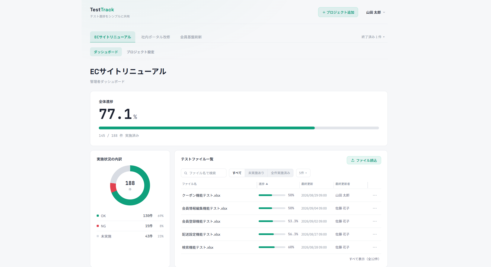
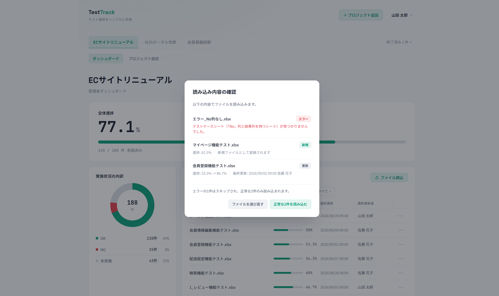
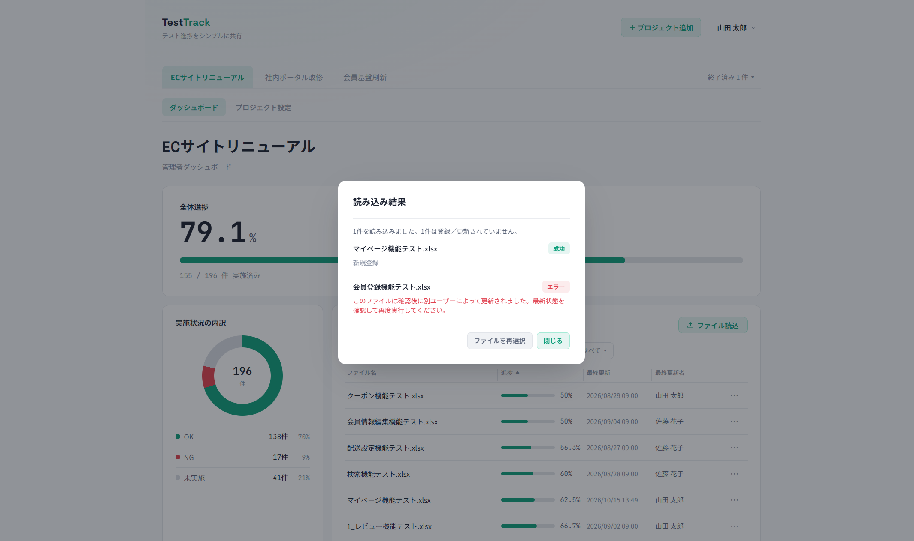
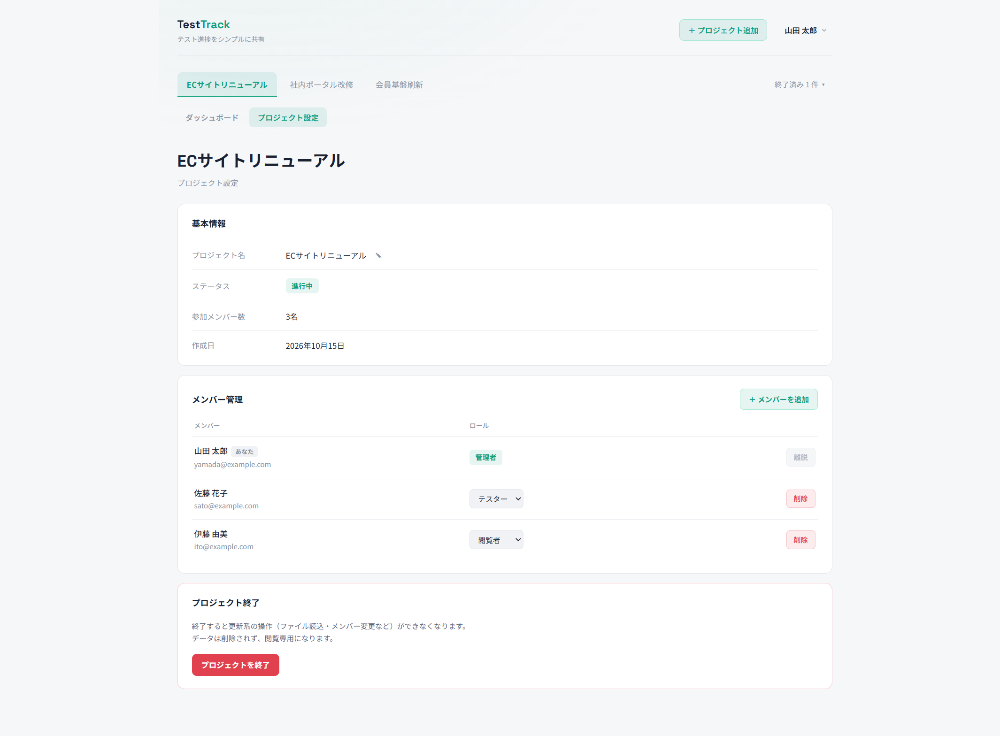
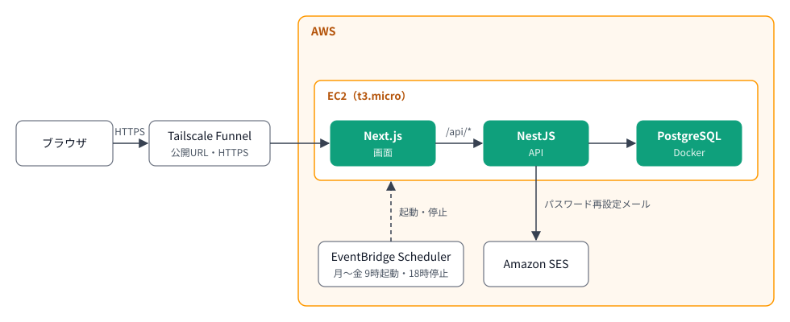
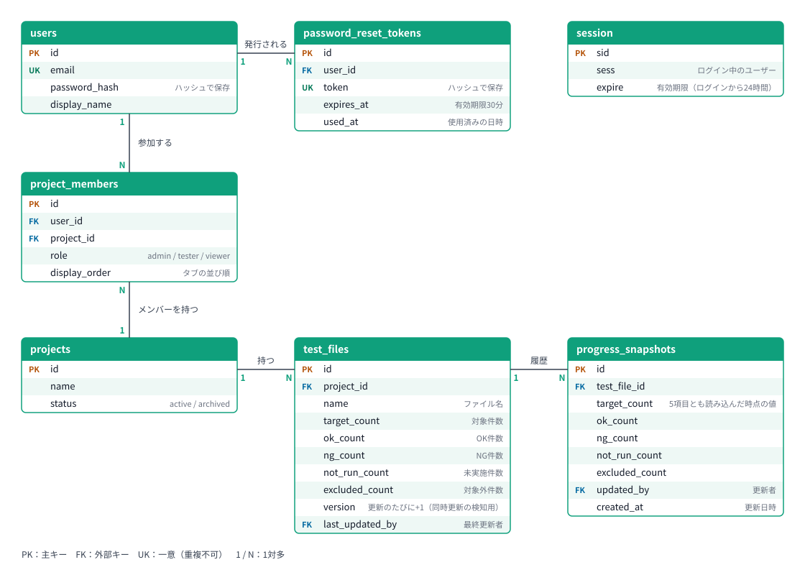

# TestTrack

テストリーダーとテスターが、Excelのテスト仕様書を読み込むだけで、プロジェクトのテスト進捗を集計・共有できるWebアプリです。



| | |
|---|---|
| 公開URL | https://testtrack.tail7f725a.ts.net/ |
| 稼働時間 | 月〜金 9〜18時（日本時間）　※時間外は停止しています |
| デモ用アカウント | ユーザー：`yamada@example.com` ／ パスワード：`testtrack-demo-2026` |

- デモデータは毎朝の起動時に初期化されますので、ファイルの読込・登録取消・メンバーの変更など、ご自由にお試しください。
- 読込に使えるExcelファイルの見本を [`samples/`](samples/) に置いています（正常に読み込めるもの・エラーになるもの）。
- プロジェクトのタブを切り替えると、管理者・テスター・閲覧者それぞれの画面を見られます。


## 目次

概要：[このポートフォリオについて](#このポートフォリオについて) ／ [AIの利用について](#aiの利用について) ／ [開発の背景](#開発の背景) ／ [想定する使い方](#想定する使い方) ／ [設計の方針](#設計の方針)\
使い方：[主な機能](#主な機能) ／ [デモの試し方](#デモの試し方) ／ [スクリーンショット](#スクリーンショット)\
設計と技術：[技術スタック](#技術スタック) ／ [技術選定の理由](#技術選定の理由) ／ [構成図](#構成図) ／ [ER図](#er図) ／ [設計判断と理由](#設計判断と理由)\
振り返りと補足：[学んだこと・苦労したこと](#学んだこと苦労したこと) ／ [今後の課題](#今後の課題) ／ [既知の制限](#既知の制限) ／ [ローカルでの起動方法](#ローカルでの起動方法)


## このポートフォリオについて

私は業務システムの保守開発など（主にC++）に約6年携わってきました。\
モダンな技術でWebアプリや業務システムを作れるようになりたいと考え、学習を兼ねて開発したポートフォリオです。\
Web開発の実務経験はLaravelで約3か月ほどで、TypeScript・NestJS・Next.js については、今回はじめて触れた技術です。


## AIの利用について

このプロジェクトはAIを使って開発しました。私とAIの役割は次のとおりです。

| 担当 | 内容 |
|---|---|
| 作者 | 画面の原案（Figmaで作成）、仕様の策定、設計判断（ロール・権限、楽観ロック、部分成功、セキュリティ方針、AWS構成と費用の判断等）、ソースレビュー、画面での動作確認、AWSの操作 |
| 対話型AI | 仕様・設計の相談相手、画面モックの作成、ソースレビューの補助 |
| Claude Code | 実装、テストコードの作成、テスト・lint の実行 |

- Claude Code による実装後、私がソースを読んで日本語にして説明・確認し、AIが実際のコードと照らし合わせて訂正・補足する「読み合わせ」をしてからコミットしました。
- 読み合わせの中で、実装が仕様や想定とずれていることに気づき、修正することもありました。
  - ロールはアカウントではなくプロジェクトごとに割り振る仕様だが、実装は管理者用とテスター用でダッシュボードの画面が別々に作られていた。プロジェクトを切り替えるとロールに応じて表示が変わるよう修正。
  - Excelファイルの読み込みで、当初の仕様に「どのシートの、どの行を見出しとして読むか」の定義がなく、実装は「先頭のシートの1行目」を前提にしていた。実際のテスト仕様書は、表紙や更新履歴のシートがあったり、表の上にタイトルが付いていたりすることが多いので、「No」列と結果列を持つシートを探して読むよう、仕様を決め直した。
- 今回はじめて触る技術について「なぜこう書くのか」をAIに質問して理解を深めました。学んだことは「学んだこと・苦労したこと」の節に記載しています。


## 開発の背景

過去に携わったプロジェクトでは、複数のExcelファイルのシートごとに、たくさんのテストケースがありました（テスター1人で数千件を担当することもありました）。進捗は、VBAで自作した簡易ツールでシートごとにケース数を集計して合計を出し、その結果をチャットでプロジェクトリーダーに報告しており、集計から報告までに手作業が入ることを不便に感じていました。

その手作業をなくす仕組みを、Webアプリ開発の学習として形にしたのが TestTrack です。


## 想定する使い方

テストの進捗を、プロジェクトのメンバーで共有するためのアプリです。使う人は、次の3種類を想定しています。

| ロール | 想定する人 | できること |
|---|---|---|
| 管理者 | テストリーダー | 進捗の確認、Excelの読込、メンバーの管理、プロジェクトの設定・終了 |
| テスター | テストを実施する人 | 進捗の確認、Excelの読込・登録取消 |
| 閲覧者 | 進捗を見るだけの人 | 進捗の確認 |

テストケースの作成・管理は、これまでどおりExcelで行います。テスターがExcelに結果（OK／NG）を記入して読み込むと、プロジェクト全体の進捗に反映されます。メンバーは全員、ダッシュボードで全体の進捗とOK／NG／未実施の内訳を確認できます。本アプリの目的は、進捗の集計と報告にかかる手作業をなくすことです。

## 設計の方針

- テストケースの作成・管理は、これまでどおりExcelで行います。TestTrack は、そのExcelファイルを読み込んで進捗を集計・共有することだけを受け持ちます。
- 読み込むのは、決まったフォーマットのExcelファイルです。
- チャットや通知などは作らず、ほかのサービスに任せる前提です。
- 障害（NGの内容）そのものの管理は対象外です。ただし、進捗率だけでは状況を見誤るおそれがあるため、OK／NGの件数の内訳は表示します。


## 主な機能

| 機能        | できること                                  |
| --------- | -------------------------------------- |
| アカウント     | ログイン・ログアウト・パスワード再設定                    |
| ダッシュボード   | 全体の進捗率と、OK／NG／未実施の内訳                   |
| テストファイル一覧 | 検索・絞り込み・並べ替え・登録取消                      |
| Excel読込   | .xlsx・.xls を複数まとめて読込。確認画面で進捗の変化を見てから実行 |
| プロジェクト    | 作成・名前の変更・終了・タブの並び替え                    |
| メンバーと権限   | 管理者・テスター・閲覧者の3ロール。メンバーの追加・ロールの変更       |


## デモの試し方

1. 公開URLを開き、デモ用アカウントでログインします。
2. 最初に開くプロジェクト「ECサイトリニューアル」のダッシュボードで、全体の進捗率とOK／NG／未実施の内訳を確認します。
3. 「ファイル読込」を押し、[`samples/`](samples/) のExcelファイルを選びます。複数まとめて選べます。
4. 確認画面で、新規・更新・エラーの区別と、更新の場合は進捗の変化を確かめて、実行します。
5. 結果画面でファイルごとの結果を確認します。読み込めたファイルは、一覧とダッシュボードの進捗に反映されます。

ファイルごとに何を確かめられるかは、[`samples/README.md`](samples/README.md) にまとめています。


## スクリーンショット

### ① テストファイル読込の確認画面
新規・更新・エラーの3ファイルをアップロードした状態です。エラーの1ファイルはスキップされ、正常な2ファイルだけが読み込みに進めます。



### ② テストファイル読込の結果画面 
成功とエラーが混ざった状態です。確認画面を開いている間に別のユーザーが同じファイルを更新したため、そのファイルだけがエラーになっています（楽観ロック）。



### ③ プロジェクト設定（メンバー管理） 
管理者は、メンバーの追加・ロールの変更・削除ができます。

      


## 技術スタック

| 分類 | 使用技術 |
|---|---|
| フロントエンド | Next.js 16（App Router）、React 19、TypeScript、CSS Modules |
| バックエンド | NestJS 12、TypeScript、Prisma 6、express-session |
| DB | PostgreSQL 16（Docker） |
| Excelの解析 | SheetJS（xlsx） |
| テスト | Vitest、Supertest（バックエンドのAPIテスト） |
| AWS | EC2（t3.micro）、EventBridge Scheduler、SES、Systems Manager（Session Manager） |
| 公開 |    Tailscale Funnel   |

## 技術選定の理由

経歴（Web実務はLaravel約3か月）を踏まえ、主に学習コストを抑えられること、情報が多いことを重視して選びました。

### フロントエンド：Next.js（React）
- 広く使われている React を学習するため、React を土台にしたフレームワークから選定（React公式のスタートガイドでも、新規構築はフレームワークから始めることが推奨されているため）
- その中で Next.js にしたのは、公式が挙げるフレームワークの中で利用者と情報が多かったため
- フォルダの置き方がそのままURLになるファイルベースルーティングなど、初学者でも構造を理解しやすいと判断したことも決め手

### バックエンド：NestJS
- フロントと同じTypeScriptで書けるよう、Node.js 系のフレームワークから選定
- その中で NestJS にしたのは、モジュール・コントローラー・サービスという構造がLaravelに近く、実務で触れた知識を活かして学習コストを抑えられると判断したため。Node.js 系で構造を持つフレームワークの中で、利用者と情報が多いことも決め手

### DB：PostgreSQL
- ロールと権限・楽観ロック・進捗の履歴など、データの整合性が大事な要件が多いため、リレーショナルDBから選定
- その中で PostgreSQL にしたのは、新規開発で標準的な選択肢とされ、Prisma・NestJS と組み合わせた情報も多かったため

### ORM：Prisma（6系）
- NestJS と組み合わせる ORM を調べ、TypeORM と Prisma の2つに絞ったうえで、次の理由から Prisma に決定
- テーブルやテーブル間の関係などのデータモデルを schema.prisma の1ファイルで定義でき、理解しやすい
- TypeORM は複雑なクエリを柔軟に書ける点が強みとされるが、TestTrack には複雑なクエリが少ないため、学習コストが低い方を優先
- Prisma6系にしたのは、7系より安定性と情報の多さを優先したため

### リポジトリ：モノレポ（frontend/ と backend/）
- フロントとバックで1つのリポジトリにまとめ、全体像とコミット履歴を1か所で追えるようにした

### インフラ：AWS（EC2 1台）
- AWS SAAの資格取得後、学んだ内容を実際の構成で使うため、AWSでのデプロイを選択
- 学習用のため費用を抑えることを優先し、次の構成にした
  - EC2 1台に Next.js・NestJS・PostgreSQL（Docker）をまとめた
  - 稼働は月〜金の9〜18時だけ（EventBridge Scheduler で自動起動・停止）
  - 公開URLとHTTPSは、独自ドメインを取らずに Tailscale Funnel で用意
  - 当初は RDS を使う予定だったが、最小構成でも RDS だけで月約21USDの見積もりだったため、接続を確かめたうえで削除し、常設はしなかった（自動バックアップなどの RDS の利点を手放すことは理解したうえで）
- サーバーへの接続は Session Managerを使用。鍵ファイルを持たずに済み、22番ポートも開けなくてよいため

## 構成図



- EC2 が起動すると、systemd がデモデータのリセット・NestJS・Next.js を自動で立ち上げます。NestJS は、リセットが終わってから起動します。
- 公開の入口は Tailscale Funnel です。PostgreSQL は EC2 の中（127.0.0.1）にだけ公開しています。

## ER図



- `test_files` は、最新の集計値を本体に持ちます。`progress_snapshots` は、読込のたびに1行ずつ増える進捗の履歴です（いつ・誰が更新したかを記録）。 
- `version` は更新のたびに1つ増えます。Excel読込の実行時に「確認したときと同じなら更新する」ための楽観ロックと、登録取消（一度も更新していないファイルだけ取り消せる）の判定に使います。
- `project_members` は「ユーザー＋プロジェクト」の組、`test_files` は「プロジェクト＋ファイル名」の組を重複不可にしています（1人1プロジェクト1ロール、同じプロジェクトに同じ名前のファイルは1つ）。
- `test_files` の `last_updated_by` と `progress_snapshots` の `updated_by` は、`users` の `id` を指す外部キーです（図では線を省略しています）。
- `session` は、express-session がログイン状態を保存するテーブルです。ユーザーIDは `sess` の中身に含まれるため、外部キーはありません。


## 設計判断と理由

### Excelファイルは保存せず、集計結果だけをDBに残す
アップロードされたExcelは、その場で読み取って集計結果だけをDBに保存し、ファイル本体は保存しない仕様です。\
理由は以下の通りです。
- ファイルを置くストレージが不要なため、費用を抑えられる
- テスト仕様書は機密を含みうるため、保持しないことで、万一漏えいしたときの影響が小さい

TestTrack から元のExcelを取り出すことはできません。元のExcelは、テスターの手元にあるものを正とします。

### 複数人が同じファイルを更新できるようにし、楽観ロックで競合を防ぐ
1つのファイルを、複数のテスターが更新できる仕様です。\
ある人が確認画面を開いている間に、別の人が同じファイルを更新した場合は、後から実行した人のそのファイルだけをエラーにします。\
理由は、ほかの人の更新に気づかないまま上書きしてしまうのを防ぐためです。\
後から実行した人は、最新の状態を確認して、もう一度読み込む必要があります。

### 一部のファイルがエラーでも、正常なファイルだけを読み込む（部分成功）
複数のファイルをまとめて読み込むとき、エラーのファイルがあっても、正常なファイルは読み込む仕様です。\
1件のエラーで全体を失敗にすると、利用者はエラーのファイルを外して選び直し、もう一度読み込む手間がかかるためです。\
その分、どのファイルが登録され、どれが登録されなかったかを利用者が把握できるようにしています。\
ファイルの形式や中身の誤りは読み込む前の確認画面に、確認後に別の人が更新していた場合などは実行後の結果画面に、ファイルごとに理由を表示します。

### 登録取消は一度も更新されていないファイルのみ
間違えて登録したファイルは取り消せますが、一度でも更新されたファイルは取り消せない仕様です。\
理由は、更新されたファイルには進捗の履歴が残っていて、取り消すとその記録まで消えてしまうためです。

### 公開デモでの判断
デモデータは、EC2の起動のたびに初期状態へ戻します。誰でもログインして操作できるため、翌日には元に戻るようにするためです。\
デモ用アカウントのパスワードは、本番ではサーバーの環境変数で必ず設定する仕様にしています。リポジトリに書いてある開発用の値は公開されるため、本番で使えてはいけないからです。設定がないときは、開発用の値で代わりに作らず、デモデータの初期化を止めて、気づけるようにしています。READMEに載せているパスワードは、公開用に本番で設定した値で、開発用の値とは別です。

### ログインの試行回数を制限
パスワードを総当たりで試されるのを防ぐため、ログインはIPアドレスごとに1分5回までの仕様です。

### 画面の配色
なるべくシンプルで分かりやすいUIを目指し、色数を絞りました。メインカラーのグリーンと、エラーや削除などを表すレッドの色調を合わせています。メインカラーは、テストの「OK」をイメージしてグリーンにしました。


## 学んだこと・苦労したこと

### NestJS の処理の順番
リクエストはガード → インターセプター → パイプ（DTOの検証）→ コントローラー → サービスの順に通ると知りました。TestTrack では、ログインの確認はガードで行うため、未ログインのリクエストは入力の検証まで進みません。プロジェクトの権限は、APIごとに条件が違いDBを調べる必要があるため、サービスで行っています。

### 古い応答による表示の上書き
通信には時間がかかるため、検索条件やプロジェクトを変えたあとに、前の条件の応答が遅れて届くことがあると知りました。そのままでは、テストファイル一覧が古い条件の結果で上書きされたり、新しい結果が届くまで前の一覧が表示されたままになったりします。useEffect のクリーンアップで遅れて届いた応答を捨て、取得結果に「どの条件で取ったか」を持たせて今の条件と一致するときだけ表示することで防ぐ作りを理解しました。

### 通信中の切り替えによる画面の書き換え    
React は画面を描き直すたびに関数を作り直すため、ボタンを押したときの処理の中からは、押した時点の値しか見えないと知りました。登録取消の通信中に別のプロジェクトへ切り替えると、前のプロジェクトの結果で今の画面を書き換えてしまうおそれがありました。そこで、描き直しても同じ1つの箱である ref に今の値を入れておき、結果が届いたときに比べることで防げることを理解しました。

### 課題の絞り込み
作り進めるうちに課題が増え、当初想定していたより時間がかかりました。公開まで作り切ることを優先して、課題を「公開までに行うタスク」と「公開後に行うタスク」に仕分けました。\
基準は以下の通りです。
- ①公開までに行うタスク：通常の操作で出会う不具合や分かりにくさ、費用やセキュリティに関わるもの
- ②公開後に行うタスク：①に当てはまらないもの（品質の改善、内部の整理、まれな操作でしか起きない不具合、開発時にしか使わない部分の問題）

作業中に新しく見つかった課題は、まず②に入れ、公開を止めるものだけを①に移しました。例えば、デモ用アカウントのパスワードをREADMEに載せて誰でも自由に操作できる状態にするため、デモデータを毎朝初期状態に戻す仕組みは①とし、公開前に入れました。「今後の課題」に挙げたものは、②に当てはまるものです。


## 今後の課題

- フロントエンドのE2Eテストコード（Playwright）を追加する
- ダッシュボード画面のソース（1ファイルで約3,000行）を部品に分ける
- サーバーの起動設定（systemd のファイル）をリポジトリで管理する
- 残っている依存ライブラリの警告に対応する（lint 用ライブラリの依存の連鎖、Prisma 7 への移行が必要なもの）

## 既知の制限

- パスワード再設定メールは、Amazon SES がサンドボックス（送信先を、事前に検証したアドレスだけに限定した状態）のため、デモ用アカウントには届きません。実際に運用する場合は、SESの本番アクセスの申請が必要になります。
- ユーザー自身によるアカウント登録・招待の機能は、MVPの対象外としました。アカウントはDBから直接追加します。
- 稼働時間外（月〜金 9〜18時 以外）は開けません。
- URL は `ts.net` のドメインになります（独自ドメインは取っていません）。企業のネットワークから開けるかは未確認です。
- 読み込めるのは、決まった形式のExcelファイル（.xlsx・.xls）だけです。No列と結果列（見出しが「実施状況」「結果」「ステータス」など）を持つシートだけを集計し、それ以外のシートは読み飛ばします。形式の見本は [`samples/`](samples/) にあります。

## ローカルでの起動方法

Node.js 24 と Docker が必要です。
```bash
# 1. DB（PostgreSQL）を起動する
cd backend
docker compose up -d

# 2. バックエンドを起動する（http://localhost:3001）
cp .env.example .env
npm install
npx prisma generate
npx prisma migrate deploy
npm run db:reset-demo   # デモデータを作る（DBのデータはすべて作り直されます）
npm run start:dev

# 3. フロントエンドを起動する（別のターミナルで。http://localhost:3000）
cd ../frontend
cp .env.example .env    # 省略可（APIの転送先の既定値は http://localhost:3001）
npm install
npm run dev
```

- 環境変数のひな形は `backend/.env.example` と `frontend/.env.example` にあります。
- 手元では、デモ用アカウントのパスワードは開発用の値（`backend/prisma/seed-config.ts` の `DEV_PASSWORD`）になります。
- バックエンドのテストは `backend` で `npm run test:e2e`です。
